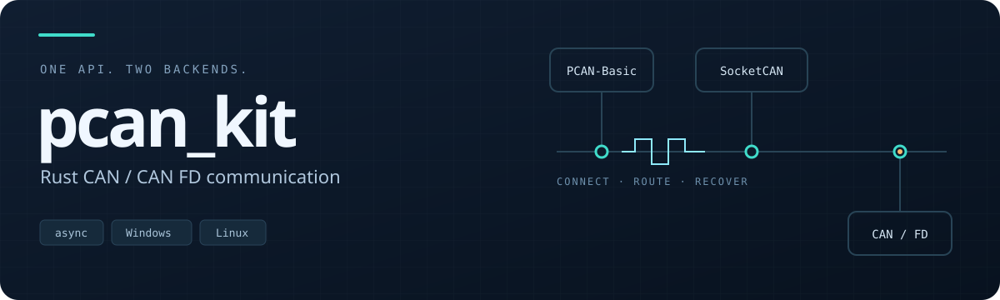
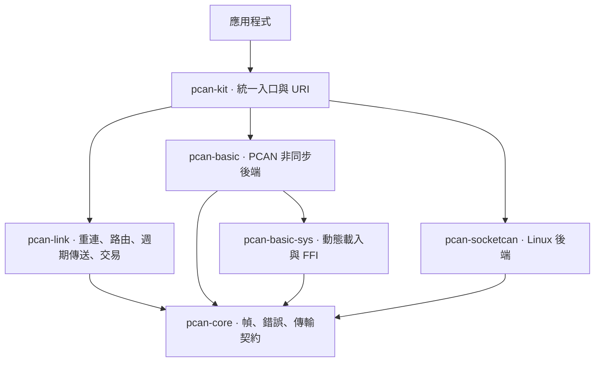

<p align="center">
  
</p>

<p align="center">
  <a href="https://github.com/liam8846/pcan_kit/actions/workflows/ci.yml"></a>
  
  
  <a href="#授權"></a>
</p>

<p align="center">
  <strong>用同一套非同步 API，操作 Windows 與 Linux 上的 CAN／CAN FD。</strong><br>
  從開啟通道到自動重連，讓驅動與平台差異留在後端。
</p>

<p align="center">
  <a href="#快速開始">快速開始</a> ·
  <a href="#架構">架構</a> ·
  <a href="docs/getting-started.md">環境設定</a> ·
  <a href="docs/testing.md">測試與驗收</a> ·
  <a href="CONTRIBUTING.md">參與開發</a>
</p>

> **首版狀態**：版本整理為 `0.1.0`，尚未發布至 crates.io。
> Windows／PEAK 實機驗收仍待完成，正式產物與驗收證據以 GitHub Release 及驗收紀錄為準。

## 為什麼使用 pcan_kit

| 一致的跨平台介面 | 可觀測的連線生命週期 | 明確的資源上限 |
|---|---|---|
| PCAN-Basic 與 SocketCAN 共用幀、錯誤和連線型別 | 自動重連、設定重放、匯流排事件與統計 | 有限傳送佇列、訂閱溢位政策、控制項目准入 |

- **CAN 與 CAN FD 使用同一個 `Frame`。** 固定 72 位元組、可 `Copy`，最多容納 64 位元組酬載。
- **內建訂閱、週期傳送與請求—回應。** 依 ID 或前綴比對回應，處理逾時、重試與多幀收集。
- **編譯不需要 PEAK SDK。** PCAN-Basic 在執行期動態載入，缺少驅動時回傳明確錯誤。
- **上層邏輯可以離開硬體測試。** 使用 `FakeTransport` 驗證重連與取消，透過 vcan 驗證 Linux 端到端通訊。

## 快速開始

需要 **Rust 1.88 以上**；從原始碼開發時使用專案固定的工具鏈。

```bash
git clone https://github.com/liam8846/pcan_kit.git
cd pcan_kit

# 列出目前可見的通道；沒有裝置也能執行
cargo run -p pcan-kit --example list_channels

# 不需要硬體的週期傳送示範
cargo run -p pcan-kit --example cyclic
```

### 在應用程式使用

目前從 Git 引入；正式使用時請鎖定已驗證的完整提交，發版後也可鎖定版本標籤。

```toml
[dependencies]
pcan-kit = { git = "https://github.com/liam8846/pcan_kit", branch = "master" }
tokio = { version = "1", features = ["rt-multi-thread", "macros", "time"] }
```

以下範例在 Linux 的 `vcan0` 接收第一個符合條件的幀，最多等待十秒。
先依[環境設定](docs/getting-started.md)建立介面，並在另一個終端送出測試幀。

```rust,no_run
use std::time::Duration;
use pcan_kit::{FilterSet, open};
use tokio::time::timeout;

#[tokio::main]
async fn main() -> Result<(), Box<dyn std::error::Error>> {
    let link = open("socketcan://vcan0").await?;
    timeout(Duration::from_secs(5), link.wait_connected()).await??;

    let mut frames = link.subscribe_filter(FilterSet::accept_all()).await?;
    if let Ok(Some(received)) = timeout(Duration::from_secs(10), frames.recv()).await {
        println!("RX: {:?}", received.frame);
    }

    link.close().await;
    Ok(())
}
```

### 更換後端，只需更換 URI

| URI | 用途 |
|---|---|
| `pcan://usb1?bitrate=500k` | PCAN-USB，古典 CAN 500 kbit/s |
| `pcan://usb1?bitrate=500k&dbitrate=2m` | PCAN-USB，CAN FD 與 BRS |
| `socketcan://can0` | Linux SocketCAN 古典 CAN |
| `socketcan://can0?fd=true` | Linux SocketCAN，啟用 CAN FD |

```bash
cargo run -p pcan-kit --example monitor -- 'pcan://usb1?bitrate=500k'
cargo run -p pcan-kit --example monitor -- 'socketcan://can0'
```

SocketCAN 的位元率、唯聽模式與 Bus-Off 自動復歸由系統介面設定；PCAN-Basic 則透過驅動設定。
不受支援的設定會明確回報，詳見[環境設定](docs/getting-started.md)。

## 架構



應用程式通常只需依賴 `pcan-kit`。`pcan-link` 透過 `TransportFactory` 重建傳輸層，
不依賴特定硬體；新增後端時可沿用上層的路由、排程與交易邏輯。

能力分成「後端做得到什麼」的 `Capabilities` 與「這次啟用了什麼」的 `ActiveFeatures`，
避免把支援 CAN FD 的裝置誤當成每次都以 FD 開啟。

進一步閱讀：[核心概念](docs/concepts.md) · [Link 執行期與資源上限](docs/link-runtime.md)

## 支援範圍

| 能力 | PCAN-Basic · Windows／Linux | SocketCAN · Linux |
|---|---|---|
| 古典 CAN、CAN FD、BRS | 依裝置與 DLL 支援 | 依介面與核心支援 |
| 非同步接收 | Win32 Event／Linux `AsyncFd` | `AsyncFd` |
| 時間戳 | 原廠硬體時間戳 | 核心時間戳，失敗時明確降級 |
| ID 過濾器 | 可表示的單一區間下推，其餘軟體過濾 | 核心 CAN filter |
| 位元率、唯聽與自動復歸 | 由驅動設定 | 由 `ip link` 設定 |
| 編譯時需要 PEAK SDK | 不需要 | 不需要 |

這是實作支援範圍；自動測試通過不等於實際 DLL、驅動與裝置已驗收。

### Cargo features

| Feature | 預設 | 用途 |
|---|:---:|---|
| `basic` | ✓ | PCAN-Basic 後端 |
| `socketcan` | ✓ | Linux SocketCAN；Windows 不引入該後端 |
| `tracing` | ✓ | 連線事件與診斷紀錄 |
| `serde` | — | 核心型別序列化與受限長度反序列化 |
| `test-util` | — | 提供 `FakeTransport` 測試工具 |

CAN FD 是執行期能力，不是 Cargo feature。只需要單一後端時可停用預設功能，明確選擇所需項目。

## 範例

| 範例 | 示範內容 | 執行環境 |
|---|---|---|
| `list_channels` | 列舉通道與能力 | 可在無硬體環境執行 |
| `monitor` | 接收第一個幀或匯流排事件 | 已設定的實體或虛擬介面 |
| `echo` | 過濾與回送 | `FakeTransport`，無硬體 |
| `cyclic` | 週期傳送、更新酬載與 detach | `FakeTransport`，無硬體 |
| `uds_request` | ID／前綴比對與請求—回應 | `FakeTransport`，無硬體 |

## 測試與發行

CI 分開驗證格式／文件、Windows／Linux、MSRV、功能組合與供應鏈。
vcan 工作會建立獨立介面，實際執行 SocketCAN、Link 端到端及介面中斷測試。

```bash
cargo fmt --all -- --check
cargo clippy --workspace --all-features --all-targets --locked -- -D warnings
cargo test --workspace --all-features --locked
```

正式標籤必須與 workspace 版本相符，且同一提交的主分支 CI 已通過。
Release 另需實機驗收者人工核准，再發布 Windows ZIP、Linux tar.gz 與 `SHA256SUMS`。
原廠 DLL、驅動與 SDK 不包含在發行檔中。

| 文件 | 內容 |
|---|---|
| [環境設定](docs/getting-started.md) | 驅動、DLL 路徑、SocketCAN 與 vcan |
| [核心概念](docs/concepts.md) | 能力、錯誤、背壓、交易與設計取捨 |
| [測試與驗收](docs/testing.md) | 本機檢查、vcan 指令與實機驗收清單 |
| [CI/CD](docs/ci-cd.md) | 新倉庫設定、文件部署與發版流程 |
| [變更紀錄](CHANGELOG.md) | 首版與後續版本的功能紀錄 |

## 授權

採 **MIT 或 Apache-2.0** 雙重授權，可任選其一。
見 [LICENSE-MIT](LICENSE-MIT) 與 [LICENSE-APACHE](LICENSE-APACHE)。
